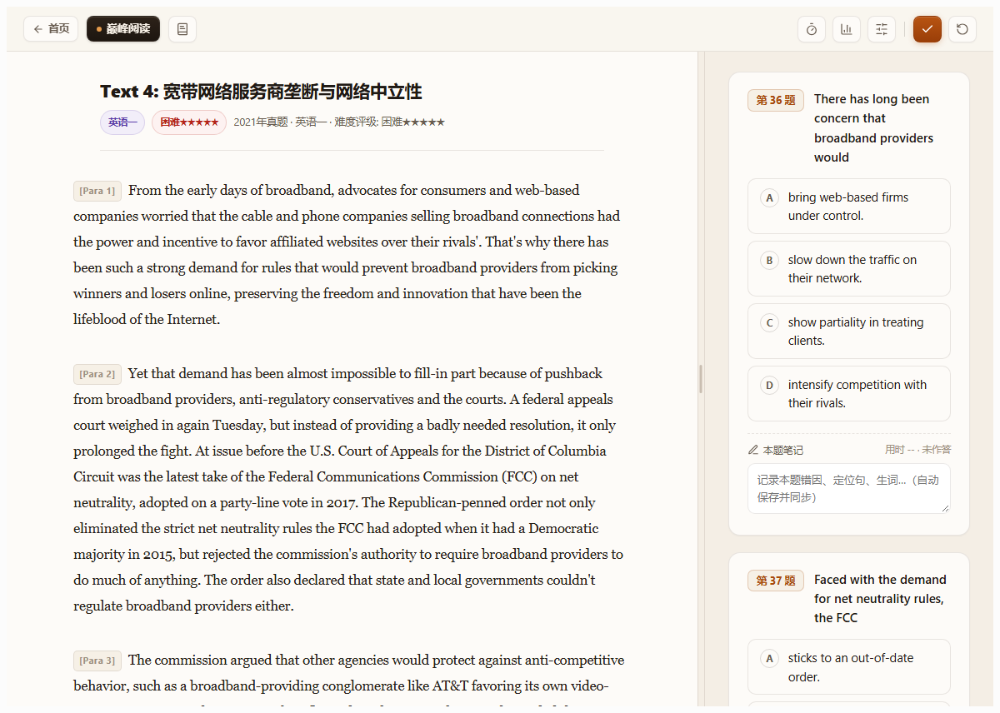
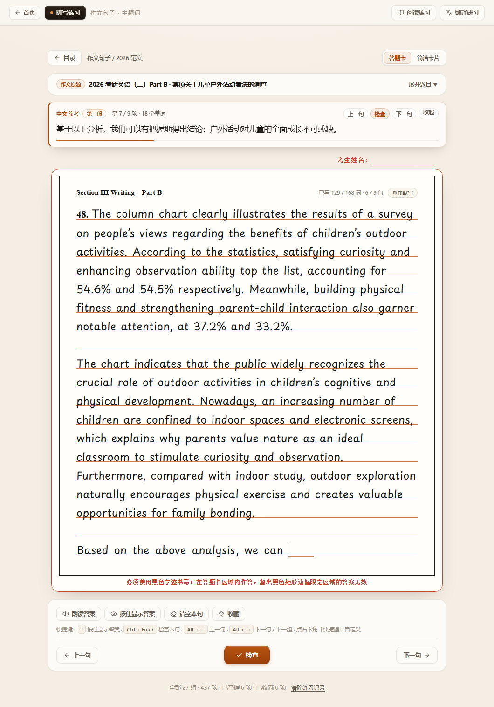
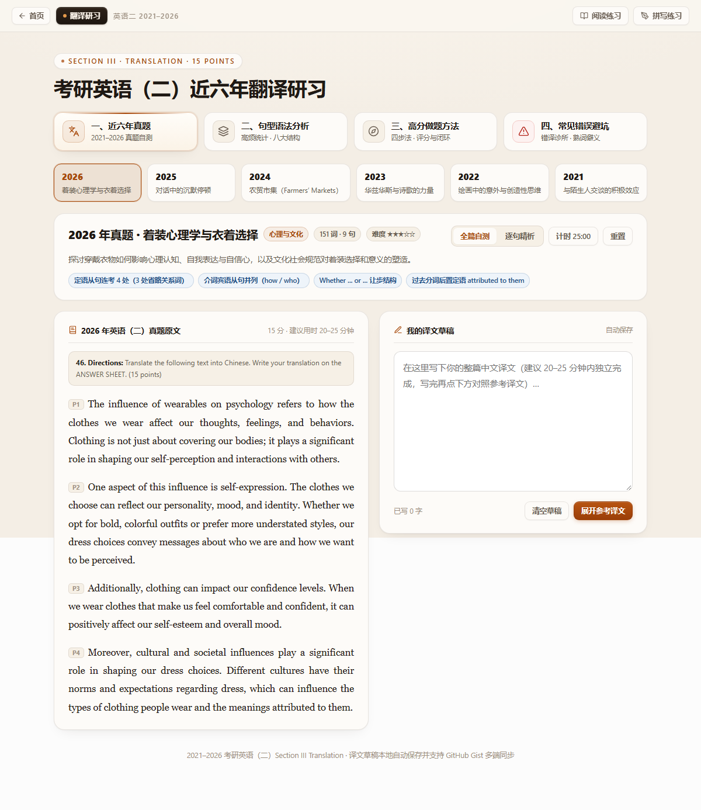

# 考研英语 N IN ONE

## 项目简介

一款零构建、可离线运行的考研英语一体化学习工具，将**真题阅读精读**、**A4 考研答题卡作文与主题词拼写**（支持外部文章导入）以及**英语二近六年翻译研习**集成在同一套轻量静态网页中，支持 PWA 安装到本地离线使用与 GitHub Gist 多端双向无损同步。

## 预览

### 首页 · 学习中心

### 阅读练习 · 左右分栏精读与逐题笔记

### 拼写练习 · A4 考研答题卡手写模式与浮动中文参考

### 翻译研习 · 真题自测、句型拆分与错译避坑

## 使用方法

1. **在线访问 / 安装为离线应用（推荐）**
   - 直接打开 [GitHub Pages 在线版](https://mintonight.github.io/kaoyan-english-n-in-one/) 即可开始练习。
   - **安装到本地离线使用**：桌面端 Chrome / Edge 点击顶栏「安装到本地」或地址栏安装图标；手机端通过浏览器菜单选择「添加到主屏幕」，断网也可完整使用。

2. **本地直接运行**
   - 下载或克隆本仓库后，直接用浏览器双击打开 `index.html` 即可使用，无需安装任何依赖或构建环境。

3. **导入外部文章（拼写模块）**
   - 进入「拼写练习」目录页，点击 **「+ 导入文章」**，粘贴符合规范的 JSON 或选择本地文件即可导入到 A4 答题卡练习。
   - 若手头只有纯英文文章，点击弹窗内的 **「一键复制 AI 提示词」**，附上文章发给任意 AI，再把回复粘贴回来即可自动识别导入。

4. **多端同步（可选）**
   - 在首页顶栏点击 **「多端同步」**，填入仅勾选 `gist` 权限的 [GitHub Token](https://github.com/settings/tokens/new?scopes=gist) 即可自动发现并双向合并云端记录（Token 仅保存在本机浏览器 `localStorage`，直连 GitHub API）。
